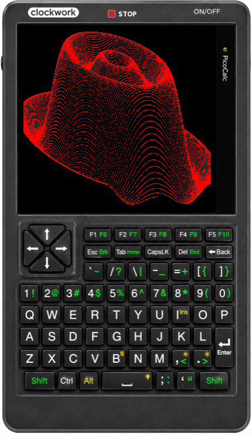
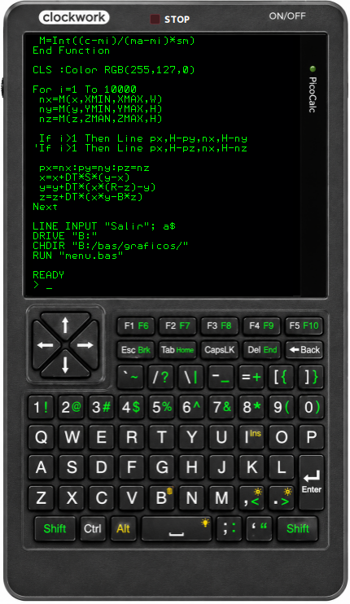
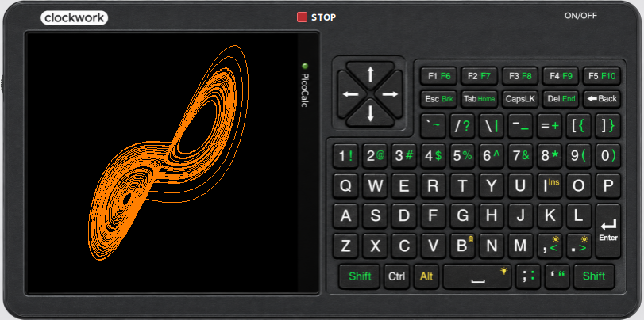

# BASIC PicoCalc Emulator

**Independent MMBasic-compatible interpreter and PicoCalc desktop emulator.**

Developed by **Ariel Palazzesi**, with technical collaboration from
**ChatGPT (OpenAI)**.

BASIC PicoCalc Emulator is an independent implementation of a BASIC
environment inspired by the PicoCalc experience. It provides a desktop
interface with a simulated LCD, keyboard, BASIC interpreter and virtual
drives.

The project aims to reproduce a useful subset of PicoCalc MMBasic
behavior while remaining independently developed. It does **not** emulate
the RP2350 processor or execute the original PicoMite firmware.
Compatibility is based on documentation and observed behavior, not a claim
of full firmware equivalence.

## Screenshots

Real screenshots of the Linux emulator running BASIC programs.

<p align="center">
  
  
</p>

<p align="center">
  
</p>

## Features

- MMBasic-compatible interpreter with graphics capabilities.
- PicoCalc-style graphical interface.
- Four photographic interface layouts.
- Virtual keyboard and LCD display.
- BASIC program loading and execution.
- Virtual drives for accessing files.
- Integrated BASIC editor.
- Spanish and English interface.
- Automated regression tests.

Compatibility is continuously tested but is not claimed to be complete.
See [Compatibility and limitations](docs/COMPATIBILITY.md) and
[How to report bugs](docs/CONTRIBUTING.md).

## Platforms

| Platform | Status |
|---|---|
| Linux | Developed and tested |
| Windows | Not supported or tested |
| macOS | Not supported or tested |

The current AppImage builder targets Linux x86_64.

## Download for Linux x86_64

**Development pre-release: v0.3.10-dev.0.**

[Download PicoCalc BASIC AppImage](https://github.com/VintaBytes/basic-picocalc-emulator/releases/download/v0.3.10-dev.0/BASIC-PicoCalc-Emulator-0.3.10.dev0-x86_64.AppImage) ·
[SHA-256 checksum](https://github.com/VintaBytes/basic-picocalc-emulator/releases/download/v0.3.10-dev.0/SHA256SUMS) ·
[Release notes](https://github.com/VintaBytes/basic-picocalc-emulator/releases/tag/v0.3.10-dev.0)

After downloading, mark the AppImage executable and run it.
No Python installation is required for this package.

## Installation from source

Python 3.10 or newer is required.

```bash
python3 -m venv .venv
source .venv/bin/activate
python -m pip install -e '.[gui,test]'
basic-picocalc
```

For complete instructions, see
[Building](docs/BUILDING.md).

## Testing

```bash
python -m pytest -q
```

Automated regression tests run on GitHub Actions before a development
AppImage is published. Tests cannot guarantee compatibility with every
PicoCalc program or MMBasic firmware version.

## Project status

**Development version: 0.3.10-dev**

The project is under active development.

The source code is publicly available in this repository.
Geoff Graham has confirmed that the eight original PicoMite ROM fonts
are covered by the MMBasic V6/V7 redistribution provisions.
The published Linux pre-release includes checked third-party license
notices; build-time checks verify their presence.

See [Third-party notices](docs/THIRD_PARTY_NOTICES.md).

## Credits

- **Ariel Palazzesi** — Project author and development.
- **ChatGPT (OpenAI)** — Technical collaboration during development.
- **Geoff Graham and Peter Mather** — MMBasic and PicoMite.
- **Blair Leduc** — Acknowledgement for work in the PicoCalc ecosystem.

The project is independent and is not an official PicoCalc,
MMBasic or PicoMite product.

## Development history

The public release history is summarized in
[CAMBIOS.md](CAMBIOS.md). Detailed internal engineering notes
are maintained separately from this public repository.

---

# Español

**Intérprete independiente compatible con MMBasic y emulador de PicoCalc
para computadoras de escritorio.**

Desarrollado por **Ariel Palazzesi**, con colaboración técnica de
**ChatGPT (OpenAI)**.

BASIC PicoCalc Emulator es una implementación independiente de un
entorno BASIC inspirado en PicoCalc.
No ejecuta el firmware PicoMite ni emula la CPU RP2350; reproduce
parte del comportamiento de MMBasic mediante una implementación propia. Incluye una interfaz gráfica que
reproduce la pantalla LCD y el teclado, un intérprete BASIC y unidades
virtuales para acceder a archivos.

## Características

- Intérprete compatible con un subconjunto de MMBasic.
- Capacidades gráficas.
- Cuatro presentaciones fotográficas de PicoCalc.
- Teclado virtual y pantalla LCD.
- Carga y ejecución de programas BASIC.
- Unidades virtuales.
- Editor BASIC integrado.
- Interfaz en español e inglés.
- Pruebas automatizadas de regresión.

La compatibilidad se encuentra en desarrollo y no se considera completa.
Consulta [Compatibilidad y limitaciones](docs/COMPATIBILITY.md) y
[Cómo reportar errores](docs/CONTRIBUTING.md).

## Sistemas operativos

- **Linux:** plataforma desarrollada y probada.
- **Windows:** no soportado ni probado.
- **macOS:** no soportado ni probado.

Actualmente contamos con un constructor AppImage para Linux x86_64.

## Descargar para Linux x86_64

**Versión preliminar de desarrollo: v0.3.10-dev.0.**

[Descargar PicoCalc BASIC AppImage](https://github.com/VintaBytes/basic-picocalc-emulator/releases/download/v0.3.10-dev.0/BASIC-PicoCalc-Emulator-0.3.10.dev0-x86_64.AppImage) ·
[Verificación SHA-256](https://github.com/VintaBytes/basic-picocalc-emulator/releases/download/v0.3.10-dev.0/SHA256SUMS) ·
[Notas de publicación](https://github.com/VintaBytes/basic-picocalc-emulator/releases/tag/v0.3.10-dev.0)

El AppImage se puede ejecutar directamente después de darle permiso de ejecución.
No requiere instalar Python.

## Instalación

En Linux, con Python 3.10 o posterior:

```bash
python3 -m venv .venv
source .venv/bin/activate
python -m pip install -e '.[gui,test]'
basic-picocalc
```

Para instrucciones completas, consultar
[Compilación e instalación](docs/BUILDING.md).

## Estado del proyecto

**Versión de desarrollo: 0.3.10-dev.**

Las pruebas de regresión se ejecutan automáticamente en GitHub Actions
antes de publicar un AppImage de desarrollo. No garantizan compatibilidad
total con cualquier programa o versión de MMBasic.

El código fuente y los recursos se encuentran publicados en este
repositorio. Geoff Graham confirmó las condiciones de redistribución
de las ocho fuentes ROM originales de PicoMite. La publicación de binarios
incluye una revisión automatizada de los avisos de licencias de las
dependencias empaquetadas.

## Reconocimientos

El proyecto reconoce el trabajo de Geoff Graham y Peter Mather
en MMBasic/PicoMite, y agradece la contribución de Blair Leduc
al ecosistema PicoCalc.

BASIC PicoCalc Emulator es un proyecto independiente.

El historial público de versiones está disponible en
[CAMBIOS.md](CAMBIOS.md). Los registros internos de ingeniería
se mantienen por separado.
